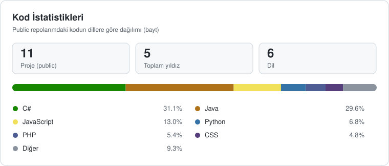

# Emircan Kılıçaslan

**Full-Stack Yazılım Geliştirici** · Ankara, Türkiye

---

### 🧠 Hakkımda

Bilkent Üniversitesi CTIS mezunuyum. İki staj ve üç tam zamanlı mühendislik deneyimim var. Web uygulamalarının arayüzden veritabanına kadar tüm katmanlarında geliştirme yaptım.

Şu an Future Ventures AG'de, finans ekiplerinin günlük işlerinde kullandığı şirket içi web uygulamalarını geliştiriyorum. Odağım, veri yoğun uygulamalarda verinin doğru ve tutarlı kalması.

- **Uzmanlık alanlarım:** web uygulamaları, API tasarımı, veritabanı yönetimi, veri yoğun arayüzler
- **Teknolojiler:** Next.js, React, TypeScript, Python, C# (.NET), Java (Spring Boot), Node.js, PostgreSQL
- **Çalışma yöntemim:** Geliştirmeyi otomatik testlerle destekler, yapılan işi commit mesajları ve README'lerle belgelerim

### 💼 Şu an: Future Ventures AG'de yazılım geliştirici (Mayıs 2026 – devam)

Özellikleri veritabanı sorgusundan API katmanına, oradan React arayüzüne kadar uçtan uca geliştiriyorum.

- **Veri yoğun arayüzler:** Büyük veri kümeleri üzerinde etkileşimli grafikler, gelişmiş filtreleme, tarih aralığı analizi ve dışa aktarma.
- **Dış veri entegrasyonları:** Harici kaynaklardan gelen veri kullanılmadan önce doğrulanıyor; kaynak yanıt vermediğinde yedek akış devreye giriyor.
- **Güvenilirlik:** İş açısından kritik hesaplamalar ve API rotaları için Vitest testleri yazıyorum. Testlerin gerçek hataları yakaladığını, koda kasıtlı hata ekleyerek doğruluyorum.
- **Süreç:** Azure DevOps üzerinde iş kalemi, pull request ve gözden geçirme akışıyla, küçük ve izlenebilir commit'lerle çalışıyorum.

**Kullandığım teknolojiler:** TypeScript, React, Next.js, Node.js, PostgreSQL, Prisma, Vitest

### ⚙️ Teknoloji Yığınım

| Seviye | Teknolojiler |
| :--- | :--- |
| **Günlük kullandığım** | TypeScript, React, Next.js, Node.js, PostgreSQL, Prisma, Tailwind CSS, TanStack Query / Table, Recharts, Vitest, Git, Azure DevOps |
| **Projelerde kullandığım** | C# / ASP.NET Core (EF Core, Dapper), Java 21 / Spring Boot, Python (FastAPI), SQL Server, Oracle, JWT, Docker, GitHub Actions, xUnit, JUnit |
| **Temel düzeyde** | Go, PHP / Laravel, SQLite, Firebase |

### 📊 Kod İstatistikleri

<!-- DIL-ISTATISTIGI:BASLA -->
<picture>
  <source media="(prefers-color-scheme: dark)" srcset="assets/diller-koyu.svg">
  
</picture>
<!-- DIL-ISTATISTIGI:BITIS -->

### 🚀 Öne Çıkan Projeler

**Kurumsal iş uygulamaları**

| Proje | Açıklama | Teknolojiler |
| :--- | :--- | :--- |
| [**ihale-takip**](https://github.com/emircankilicaslan/ihale-takip) | Kamu ihale süreç takibi API'si ve web arayüzü: taslaktan sözleşmeye durum akışı, tutara göre onay kademeleri, iş günü ve tatil bilen süre hesabı, rol ve birim bazlı yetki, kullanıcı yönetimi ve giriş kilidi, arama ve süzgeçler, Excel/CSV dışa aktarma, Swagger, Oracle tetikleyicisiyle değiştirilemez denetim kaydı, Active Directory ile giriş seçeneği. Her push'ta Oracle'a karşı 292 test, Docker imajı derleme ve açılış testi | Java 21, Spring Boot 3, Oracle, Flyway, JWT, Active Directory (LDAP), JUnit, Docker |
| [**evrak-takip**](https://github.com/emircankilicaslan/evrak-takip) | Kurum evrak yönetimi (EBYS) ve 4982 bilgi edinme başvuru takibi: gelen/giden evrak, havale zinciri, görevler ayrılığıyla imza, iş günü bazlı cevap süresi, gizlilik dereceli görünürlük (GİZLİ evrak yetkisize 404), arşiv ve imha tarihi, bilgi edinmede gerekçeli tek seferlik uzatma ve KVKK maskeleme, panel ve grafikler, Excel/CSV dışa aktarma, Swagger, Oracle tetikleyicisiyle değiştirilemez denetim kaydı, Active Directory ile giriş seçeneği. Her push'ta Oracle'a karşı 214 test metodu ve Docker açılış testi | Java 21, Spring Boot 3, Oracle, Flyway, JWT, Active Directory (LDAP), JUnit, Docker |
| [**StaffDesk**](https://github.com/emircankilicaslan/StaffDesk) | Personel izin ve zimmet yönetimi API'si ve rol bazlı web portalı: onay akışı, bakiye ve iş günü hesabı, birim bazlı yetki, rol kapsamlı pano, ekip takvimi, arama/süzgeç, demirbaş garanti takibi, denetim kaydı, Excel dışa aktarma (202 test) | Java 21, Spring Boot, PostgreSQL, Flyway, JWT, Docker, JUnit |
| [**FacilityOps**](https://github.com/emircankilicaslan/FacilityOps) | Tesis bazlı arıza/talep takip API'si ve SLA göstergeli web paneli: SLA takibi, genel denetim kaydı (audit log), atanan ve metin filtreleri, CSV ve Excel dışa aktarma, rol bazlı yetki, SQL Server desteği | C#, ASP.NET Core, EF Core, SQL Server, JWT, Docker, xUnit |
| [**BookTrack**](https://github.com/emircankilicaslan/BookTrack) | Kütüphane ödünç takibi: iş günü bazlı teslim tarihi, gecikme cezası, ödünç uzatma, sunucu taraflı arama/süzgeç/sıralama/sayfalama, rapor paneli ve grafikler, geciken ödünç listesi, CSV/Excel dışa aktarma (ek paketsiz), denetim kaydı, JWT ve rol bazlı yetki (Admin / Görevli), eş zamanlılık koruması; web arayüzü, Docker ve 181 otomatik test (gerçek SQL Server testleri dahil) | C#, ASP.NET Core 8, EF Core, SQL Server, JWT, Docker, xUnit |
| [**AssetPulse**](https://github.com/emircankilicaslan/AssetPulse) | Altyapı varlıkları (trafo, pist ışıklandırma, sinyal panosu) için ölçüm toplama ve alarm platformu: REST API + MVC operatör paneli, art arda ihlal ve histerezisli kurallar, alarm yaşam döngüsü, grafikler, denetim kaydı (audit log), Excel/CSV çıktısı | C#, ASP.NET Core 8 (API + MVC/Razor), Dapper, T-SQL, SQL Server, Bootstrap, Chart.js, JWT, xUnit |

**Entegrasyon ve altyapı**

| Proje | Açıklama | Teknolojiler |
| :--- | :--- | :--- |
| [**e-belge-project**](https://github.com/emircankilicaslan/e-belge-project) | e-Fatura / e-Arşiv alış-satış fatura yönetimi (demo), UBL-TR XML çıktısı | PHP, JavaScript, PHPUnit |
| [**Go-React-SSH-Terminal**](https://github.com/emircankilicaslan/Go-React-SSH-Terminal) | Tarayıcıdan SSH terminali: şifreli parola saklama, tek kullanımlık WebSocket bileti, host key doğrulama | Go, React, WebSocket, SQLite |

**Diğer**

| Proje | Açıklama | Teknolojiler |
| :--- | :--- | :--- |
| [**task-manager**](https://github.com/emircankilicaslan/task-manager) | Görev yönetimi: token tabanlı kimlik doğrulama, yetkilendirme politikaları, filtreleme ve sayfalama | Laravel 11, Next.js 14, TypeScript, PHPUnit, Vitest |
| [**brand-intelligence-agent**](https://github.com/emircankilicaslan/brand-intelligence-agent) | Bir moda markası için yalnızca ad ve web adresinden Marka DNA raporu üreten ajan | Python, CLIP, scikit-learn, LLM |

#### Arayüzlerden görünümler

| StaffDesk · kurum panosu | FacilityOps · SLA takibi | AssetPulse · varlık sağlığı paneli |
| :---: | :---: | :---: |
|  |  |  |

| ihale-takip · genel bakış | ihale-takip · teklif değerlendirme | ihale-takip · karar ve itiraz süresi |
| :---: | :---: | :---: |
|  |  |  |

**Projelerimde uyguladığım yöntemler:** GitHub Actions ile her push'ta otomatik derleme ve test, veritabanı değişiklikleri için migrasyon (EF Core, Flyway, Laravel), JWT ve rol bazlı yetkilendirme, girdi doğrulama, Docker ile paketleme ve mimari kararların README'de belgelenmesi.

### 🎓 Eğitim

Bilkent Üniversitesi, Bilgisayar Teknolojisi ve Bilişim Sistemleri (CTIS), mezun

### 📫 İletişim

